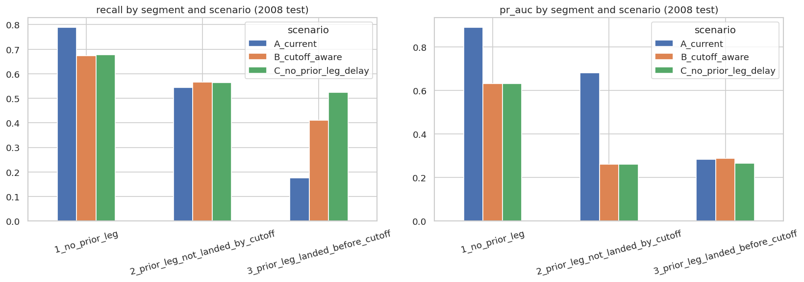

# TurnAhead: Flight Departure-Delay Early Warning

Predicting which US flights will depart 15+ minutes late, and turning those predictions into risk tiers for teams that can only act on a small share of flights.

  

## TL;DR

- **Problem:** flag flights likely to depart 15+ minutes late, so limited operational effort goes where it matters.
- **Data:** ~17M US flights (Jan 2006 to Apr 2008), about 12M modeled after cleaning (top-40 origin airports).
- **Best model:** calibrated LightGBM. On the 2008 hold-out it reaches ROC-AUC **0.873**, PR-AUC **0.783**, precision **0.725**, recall **0.650**, F1 **0.686**, Brier **0.100**.
- **Key caveat, tested explicitly:** about 60% of that model's gain comes from aircraft-rotation features (prior-leg arrival delay and scheduled turn time). When predictions are restricted to what is known **2 hours before departure**, ROC-AUC falls to **0.702** and PR-AUC to **0.407**. That is still better than the historical-rate baseline (ROC-AUC 0.655, PR-AUC 0.331), but far from the headline numbers.
- **Honest summary:** a same-day "the plane is already landing late" signal is very strong; a genuine 2-hour-ahead warning is only moderately predictive using schedule, route and historical features alone.

## Table of contents

1. [Problem and motivation](#problem-and-motivation)
2. [Data](#data)
3. [Approach](#approach)
4. [Results](#results)
5. [Prediction-cutoff analysis](#prediction-cutoff-analysis)
6. [Where the model is weak](#where-the-model-is-weak)
7. [Key EDA findings](#key-eda-findings)
8. [Limitations](#limitations)
9. [Repository structure](#repository-structure)
10. [How to reproduce](#how-to-reproduce)
11. [What I learned](#what-i-learned)
12. [Next steps](#next-steps)

## Problem and motivation

Departure delays cascade through an airline network. If an operations team can only act on a small fraction of flights (for example, re-sequencing turnarounds, staging ground crews, or notifying passengers early), the useful question is not just "will this flight be late?" but **"which 5-15% of flights should we look at first?"**

The target is `is_delayed_15`: a flight departs at least 15 minutes after its scheduled time. The outputs are a calibrated delay probability and three priority tiers: *normal monitoring*, *watchlist* and *proactive intervention*.

## Data

- **Source:** US airline on-time performance data from the Data Expo 2009 ([Kaggle dataset](https://www.kaggle.com/datasets/wenxingdi/data-expo-2009-airline-on-time-data)).
- **Window:** January 2006 to April 2008 (16,984,354 raw flights, 311 origin airports).
- **Scope:** the top 40 origin airports, covering 71.98% of all flights.
- **Modeled rows:** 11,957,343 flights. Cancelled (1.98%) and diverted (0.22%) flights are audited separately and excluded from modeling.
- **Class balance:** about 22% of flights are delayed 15+ minutes.

| Split | Period | Flights | Delay rate |
|---|---|---|---|
| Train | 2006-01 to 2007-06 | 7,678,164 | 21.95% |
| Validation | 2007-07 to 2007-12 | 2,624,868 | 22.27% |
| Test | 2008-01 to 2008-04 | 1,654,311 | 22.80% |

The raw data is not included in this repository. The notebook downloads it through `kagglehub`.

## Approach

1. **Ingestion:** chunked CSV to Parquet conversion with schema enforcement and row-count validation.
2. **Data-quality gates:** invalid or placeholder tail numbers (1.43%), duplicates, implausible tail-days, time-zone offset audit, and schedule-field checks.
3. **EDA:** delay patterns by hour, carrier, origin, distance, month, delay cause, and cancellations.
4. **Aircraft-rotation features:** each flight is linked to the same aircraft's previous leg to get `prior_leg_arrival_delay` and `sched_turn_min` (about 71% of flights have a valid prior-leg link).
5. **Past-only historical rates:** delay rates by carrier, origin, route and scheduled hour, computed using only earlier data, with smoothing and a fallback rate for unseen groups.
6. **Models:**
   - Historical-rate heuristic (baseline)
   - Logistic regression (baseline)
   - LightGBM, with a small validation search over two configurations
7. **Calibration:** sigmoid calibration fit on Jul-Sep 2007; priority thresholds set on Oct-Dec 2007 (85th and 95th percentile of calibrated risk).
8. **Evaluation:** a chronological hold-out, with the test set used once for final reporting. Metrics are ROC-AUC, PR-AUC, precision, recall, F1 and Brier score, plus an intervention-budget analysis and a subgroup error analysis.
9. **Leakage controls:** a forbidden-feature list (actual departure/arrival times, delay minutes, delay-cause fields) is enforced with assertions, and delay-cause fields are used for description only.

## Results

### Model comparison (2008 test set)

| Model | ROC-AUC | PR-AUC | Precision | Recall | F1 | Brier |
|---|---|---|---|---|---|---|
| Historical heuristic | 0.655 | 0.331 | 0.308 | 0.674 | 0.423 | 0.170 |
| Logistic regression | 0.841 | 0.708 | 0.629 | 0.648 | 0.638 | 0.155 |
| **LightGBM (calibrated)** | **0.873** | **0.783** | **0.725** | **0.650** | **0.686** | **0.100** |

Thresholds for precision, recall and F1 were selected on validation data only. Validation results (LightGBM ROC-AUC 0.878, PR-AUC 0.787) are close to test, so there is no sign of overfitting to the validation period.

These numbers use all features, including prior-leg arrival delay, and do not restrict the prediction time. See the [prediction-cutoff analysis](#prediction-cutoff-analysis) for the realistic version.

### Priority tiers (frozen thresholds, 2008 test set)

The "normal monitoring" tier contains 84.02% of flights, with an 11.59% delay rate. It still holds 42.70% of all delays, which is why tiering alone cannot catch every delay. The proactive threshold flagged 5.26% of test flights, close to its 5% design target.

### Robustness check

A model trained on 2006 only and evaluated on all of 2007 scored ROC-AUC 0.873 and PR-AUC 0.782. Ranking performance is similar across that time shift. Note that 2007 also informed the main model-selection process.

### What drives the model

| Feature family | Share of gain |
|---|---|
| Aircraft rotation (`prior_leg_arrival_delay`, `sched_turn_min`) | 59.74% |
| Carrier and route | 19.16% |
| Schedule and calendar | remainder |

`prior_leg_arrival_delay` alone contributes 44.41% and `sched_turn_min` 15.33%. This is model importance, not causal evidence.

## Prediction-cutoff analysis

**Why this matters:** an "early warning" must only use information available when the warning is issued. The prior leg's arrival delay is often only known shortly before departure, and sometimes the aircraft lands after the flight's scheduled departure, which makes a delay close to certain.

**Setup:** predictions are assumed to be made **120 minutes before scheduled departure**. The prior leg's actual arrival counts as known only if it landed at least 120 minutes before this flight's scheduled departure (`sched_turn_min - prior_leg_arrival_delay >= 120`). Otherwise the feature is masked as missing. All scenarios use the same splits, the same LightGBM configuration and number of boosting rounds, and the same calibration protocol. Nothing was tuned on the test set.

- **A:** all features, no cutoff (the original model)
- **B:** prior-leg arrival delay available only if it was known at T-120
- **C:** prior-leg arrival delay removed entirely (scheduled turn time kept)

### Test-set metrics (2008)

| Scenario | ROC-AUC | PR-AUC | Precision | Recall | F1 | Brier | Flagged |
|---|---|---|---|---|---|---|---|
| A: no cutoff | 0.873 | 0.783 | 0.725 | 0.650 | 0.686 | 0.100 | 20.5% |
| B: cutoff-aware (T-120) | 0.702 | 0.407 | 0.357 | 0.613 | 0.451 | 0.160 | 39.1% |
| C: no prior-leg delay | 0.700 | 0.407 | 0.354 | 0.616 | 0.450 | 0.160 | 39.7% |

Validation results follow the same pattern (PR-AUC 0.787 for A, 0.434 for B, 0.432 for C).

### Intervention-budget results (2008 test set)

Share of all delayed flights captured when only the top K% of flights can be acted on:

| Budget | Random | Historical heuristic | A: no cutoff | B: cutoff-aware | C: no prior-leg delay |
|---|---|---|---|---|---|
| 5% | 5.00% | 8.54% | 21.92% | 12.05% | 12.04% |
| 10% | 10.00% | 17.17% | 42.32% | 21.45% | 21.42% |
| 15% | 15.00% | 25.05% | 55.31% | 29.77% | 29.80% |

Precision among the flagged flights (share that were truly delayed):

| Budget | A: no cutoff | B: cutoff-aware | C: no prior-leg delay |
|---|---|---|---|
| 5% | 99.94% | 54.95% | 54.89% |
| 10% | 96.49% | 48.90% | 48.84% |
| 15% | 84.08% | 45.25% | 45.30% |

### Interpretation

1. **The headline numbers describe a different use case.** Scenario A's 99.94% precision at the top 5% mostly reflects flights whose aircraft is already landing late. That is valuable for same-day operations, but it is not a 2-hour-ahead warning.
2. **A realistic 2-hour warning is moderate.** With a T-120 cutoff, ROC-AUC drops from 0.873 to 0.702 and PR-AUC from 0.783 to 0.407.
3. **It still adds value over simple rules.** Compared with the historical heuristic, the cutoff-aware model improves ROC-AUC (0.702 vs 0.655) and PR-AUC (0.407 vs 0.331). At a 5% budget it captures about 2.4x the delays that random selection would, versus about 1.7x for the heuristic.
4. **Scenarios B and C are almost identical.** At 2 hours before departure, the prior-leg delay is rarely known yet, so removing it changes almost nothing. In that regime the signal comes from schedule, route, carrier and historical delay rates.
5. **The cutoff estimates are conservative.** They do not use live in-flight arrival estimates for aircraft that are still airborne at T-120. A system with a live ETA feed could recover part of the gap between A and B.

Full tables: `reports/scenario_comparison.csv`, `reports/scenario_budget_test.csv`.

## Where the model is weak

Segment analysis on the 2008 test set (`reports/segment_analysis_test.csv`) splits flights into three groups: no prior leg (first flight of the day), prior leg not yet landed at the cutoff, and prior leg landed before the cutoff.



Other findings from the subgroup error analysis of the original model:

- **Early-morning departures:** recall is only 3.76% for the 06:00 hour and 12.37% for the 07:00 hour at the frozen validation threshold. First flights of the day have no prior leg, so the strongest feature is missing.
- **Delay severity:** recall is about 74-75% for delays of 60+ minutes but only 54% for delays of 15-29 minutes. The model catches big disruptions better than marginal ones.
- **Some carriers and airports** (for example HA and HNL) show lower recall. See `reports/test_subgroup_error_analysis.csv`.

## Key EDA findings

- 77.86% of flights depart on time (<15 min delay), yet the delayed 22% account for about 90% of all delay minutes.
- Delay rate climbs through the day, from about 6% for 06:00 departures to about 34% by 20:00, consistent with delay propagation along aircraft rotations.
- Carrier delay rates range widely (for example EV 33% vs DL 18%).
- Among attributed delay minutes, late-arriving aircraft cause 37.5%, carrier 29.3%, air-traffic/NAS 27.5%, weather 5.6% and security 0.2%. Cause fields describe arrival delay and are never used as features.
- Cancellations peak in winter (4.5% in Feb 2007), with carrier and weather causes dominating.

Figures: `reports/figures/eda_*.png`.

## Limitations

- **Fixed cutoff:** the cutoff analysis assumes a single 120-minute horizon and does not use in-flight ETAs. Other horizons (for example 30 or 60 minutes) would give different results.
- **No weather or air-traffic data**, which are known drivers of delays.
- **First-of-day blind spot:** the strongest feature is unavailable for the earliest departures, where the model is weakest.
- **Selection:** cancelled and diverted flights are excluded from modeling.
- **Time window:** the test period is January to April 2008 only (winter-heavy), so conclusions may not generalize to other seasons or to modern operations.
- **Logistic regression** hit its iteration limit and is likely not fully converged. It is used as a baseline only.
- **Model selection scope:** only two LightGBM configurations were compared, and `route` is a 3,166-level categorical feature, which may overfit.
- **Importance is not causation:** feature importance describes the model, not the real-world causes of delays.

## Repository structure

```
turnahead-flight-delay/
├── README.md
├── requirements.txt
├── .gitignore
├── notebooks/
│   └── turnahead_delay_prediction.ipynb
└── reports/
    ├── scenario_comparison.csv
    ├── scenario_budget_test.csv
    ├── segment_analysis_test.csv
    ├── test_model_metrics.json
    ├── test_priority_tiers.csv
    ├── test_intervention_budget.csv
    ├── test_subgroup_error_analysis.csv
    ├── operational_thresholds.json
    ├── lightgbm_feature_importance_summary.csv
    └── figures/
        ├── segment_recall_prauc.png
        ├── test_calibration_curves.png
        ├── test_intervention_budget.png
        └── eda_*.png
```

Trained models, Parquet files and raw data are intentionally not committed (size).

## How to reproduce

1. Open `notebooks/turnahead_delay_prediction.ipynb` on [Kaggle](https://www.kaggle.com/) and attach the dataset `wenxingdi/data-expo-2009-airline-on-time-data` (or let the first cells download it with `kagglehub`).
2. Install dependencies if running locally:

```bash
pip install -r requirements.txt
```

3. Run all cells in order. Expect roughly 1-2 hours; ingestion takes minutes and LightGBM training (about 15-20 minutes per model) is the slowest part.
4. Outputs are written to `/kaggle/working/reports/`.

Everything is seeded (`RANDOM_SEED = 42`), but LightGBM multithreading can still cause small numeric differences between runs.


## Next steps

- Add weather and air-traffic features.
- Try other prediction horizons (30, 60, 180 minutes) and add in-flight ETA features.
- Model first-of-day flights separately.
- Build a Streamlit dashboard for the report tables and figures.
- Evaluate on other seasons and years.

## Author

**Piyush Kumar**: github.com/Piyushgh07> | pk30082004@gmail.com

Built as a portfolio project in data analysis and machine learning for aviation operations.